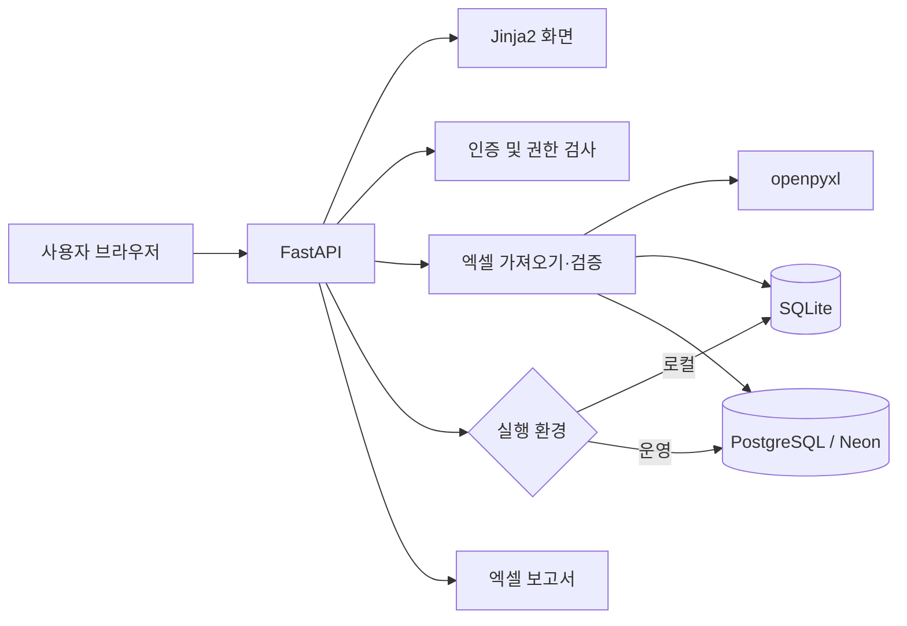

# B2C 판매 관리 시스템

여러 판매채널에서 내려받은 엑셀 자료를 하나의 형식으로 통합하고, 매출·정산·세무 데이터를 관리하는 사내 웹 서비스입니다.

채널마다 흩어져 있던 주문 자료를 수작업으로 합치고 검수하던 과정을 줄이기 위해 만들었습니다. 원본 파일 업로드부터 중복 확인, 매출 대사, 회계자료 산출까지 한 화면에서 처리할 수 있습니다.

## 주요 기능

### 판매 데이터 통합

- 네이버, 쿠팡, 카페24 등 10개 판매채널의 엑셀 시트 통합
- 채널별 주문번호, 결제일, 상품 옵션, 결제금액, 수수료, 정산금액 표준화
- 행 단위 지문(fingerprint)을 이용한 중복 업로드 방지
- 업로드 전 신규·중복·확인 필요 건수 미리보기
- 원본 엑셀과 업로드 이력 보관

### 조회 및 분석

- 월별·채널별 매출과 판매수량 대시보드
- 주문번호, 구매자, 기간, 채널, 검수 상태를 이용한 판매내역 검색
- 판매내역 수정, 검수 상태 기록 및 집계 제외
- 제품·결제수단·부가세·수수료 기준의 분석자료 제공
- 화면에 적용한 조건을 반영한 엑셀 내보내기

### 검증 및 회계 처리

- 업로드 원본과 현재 DB 자료의 건수·수량·매출 대사
- 누락, 0원 거래, 중복 의심 거래, 검수 필요 항목 확인
- 차변·대변 및 결제수단별 공급가액·부가세 집계
- 홈택스 자료와 웹 판매자료 비교
- 미지정 홈택스 거래의 판매채널 수동 매핑

### 운영 관리

- 업로드 단위 취소, 복구 및 영구 삭제
- 관리자·검수자·조회자 역할에 따른 접근 제어
- 비밀번호 PBKDF2 해싱과 만료 시간이 있는 로그인 세션
- 사용자 생성, 권한 변경, 계정 비활성화 및 비밀번호 초기화
- 주요 작업 감사 로그 기록

| 역할 | 권한 |
| --- | --- |
| 관리자 | 전체 기능과 사용자 관리 |
| 검수자 | 판매내역 검수·수정, 조회 및 내보내기 |
| 조회자 | 대시보드와 자료 조회 |

## 지원 판매채널

| 판매채널 | 인식 가능한 시트명 |
| --- | --- |
| 네이버 | `네이버`, `Naver` |
| 쿠팡 | `쿠팡`, `Coupang` |
| 카페24 | `카페24`, `Cafe24` |
| 11번가 | `11번가` |
| SSG | `SSG` |
| 지마켓 | `지마켓`, `G마켓` |
| 옥션 | `옥션` |
| 베네피아 | `베네피아` |
| 현대홈쇼핑 | `현대홈쇼핑` |
| 현대백화점 | `현대백화점` |

각 시트의 3번째 행을 헤더로 사용하며, 판매 데이터는 4번째 행부터 읽습니다. 지원하지 않는 시트는 가져오지 않습니다.

## 시스템 구조



별도 프런트엔드 프레임워크 없이 FastAPI가 Jinja2 화면과 정적 파일을 제공합니다. 데이터 접근 코드는 SQLite와 PostgreSQL에서 같은 쿼리를 사용할 수 있도록 연결 계층에서 차이를 처리합니다. `DATABASE_URL`의 유무에 따라 사용할 DB가 결정됩니다.

### 데이터 처리 흐름

```text
엑셀 업로드
  → 파일 형식과 시트 확인
  → 행별 데이터 정규화 및 검증
  → fingerprint 기반 중복 판별
  → 신규·중복·오류 내역 미리보기
  → 사용자 확인 후 DB 반영
  → 대시보드·매출 대사·회계자료 자동 집계
```

업로드를 취소하면 해당 배치의 자료만 집계에서 제외되고 원본과 이력은 남습니다. 다시 복구할 수 있으며, 영구 삭제를 선택한 경우에만 관련 판매자료와 검증 결과, 원본 파일을 함께 삭제합니다.

## 기술 스택

| 구분 | 사용 기술 |
| --- | --- |
| Backend | Python, FastAPI, Uvicorn |
| Template | Jinja2 |
| Frontend | HTML, CSS, JavaScript |
| Excel | openpyxl |
| Database | SQLite, PostgreSQL, psycopg |
| Authentication | Cookie session, PBKDF2-HMAC-SHA256 |
| Deployment | Render, Neon |

## 프로젝트 구성

```text
app/
├─ main.py                     # 라우팅, 조회, 집계, 엑셀 내보내기
├─ database.py                 # DB 연결과 스키마 초기화
├─ security.py                 # 비밀번호, 세션, 최초 관리자 생성
├─ services/
│  ├─ excel_importer.py        # 엑셀 파싱, 정규화, 중복 판별
│  ├─ data_validator.py        # 원본 파일과 DB 자료 대사
│  └─ channel_adapters.py      # 판매채널별 시트명·헤더 대응
├─ templates/                  # Jinja2 화면 템플릿
├─ static/                     # CSS와 브라우저 JavaScript
└─ assets/                     # 엑셀 출력 템플릿
scripts/                       # 데이터 이전·점검·보정 도구
tests/                         # 가져오기, 인증, 회계, 복구 검증
render.yaml                    # Render 배포 설정
run.ps1                        # Windows 로컬 실행 스크립트
```

## 로컬 실행

### 1. 가상환경과 패키지 설치

```powershell
python -m venv .venv
.\.venv\Scripts\Activate.ps1
pip install -r requirements.txt
```

### 2. 서버 시작

```powershell
.\run.ps1
```

서버가 시작되면 [http://127.0.0.1:8002](http://127.0.0.1:8002)로 접속합니다. 같은 네트워크의 다른 PC에서 접속할 때 사용할 주소도 실행 창에 표시됩니다.

### 3. 최초 로그인

처음 실행할 때 등록된 사용자가 없으면 관리자 계정을 자동으로 만듭니다.

- `INITIAL_ADMIN_PASSWORD`가 설정되어 있으면 해당 비밀번호를 사용합니다.
- 설정하지 않은 경우 임시 비밀번호를 생성해 `data/initial_admin_credentials.txt`에 저장합니다.
- 최초 로그인 후에는 비밀번호를 변경해야 합니다.

## 환경변수

| 이름 | 설명 | 기본 동작 |
| --- | --- | --- |
| `DATABASE_URL` | PostgreSQL 연결 문자열 | 미설정 시 `data/sales.db` 사용 |
| `INITIAL_ADMIN_USERNAME` | 최초 관리자 아이디 | `admin` |
| `INITIAL_ADMIN_PASSWORD` | 최초 관리자 비밀번호 | 미설정 시 임시 비밀번호 생성 |

비밀번호는 10자 이상이어야 하며 영문자, 숫자, 특수문자를 각각 하나 이상 포함해야 합니다. 예시는 `.env.example`에서 확인할 수 있습니다.

## 테스트

핵심 기능별 검증 스크립트는 `tests` 디렉터리에 있습니다. 테스트 도구를 설치한 뒤 전체 Python 테스트를 실행합니다.

```powershell
pip install pytest httpx
.\.venv\Scripts\python.exe -m pytest
```

## 배포

운영 환경은 Render Web Service와 Neon PostgreSQL을 기준으로 구성되어 있습니다. `render.yaml`의 Blueprint를 사용하고, Render에서 아래 환경변수를 등록합니다.

```env
DATABASE_URL=postgresql://...
INITIAL_ADMIN_USERNAME=admin
INITIAL_ADMIN_PASSWORD=10자 이상 영문자·숫자·특수문자 포함
```

헬스체크 경로는 `/health`입니다. DB 쿼리를 실행하지 않아 서비스 프로세스의 동작 여부만 가볍게 확인할 수 있습니다.

### SQLite 데이터를 Neon으로 이전하기

기존 로컬 데이터를 빈 Neon DB로 옮길 때는 현재 PowerShell 세션에 연결 문자열을 설정한 뒤 이전 스크립트를 실행합니다.

```powershell
$env:DATABASE_URL = "postgresql://..."
.\.venv\Scripts\python.exe scripts\migrate_to_neon.py --yes
```

대상 DB에 데이터가 하나라도 있으면 이전을 중단합니다. 사용자와 비밀번호 해시, 판매내역, 홈택스 자료, 작업 이력, 업로드 원본이 함께 복사되며 로그인 세션은 이전하지 않습니다.
